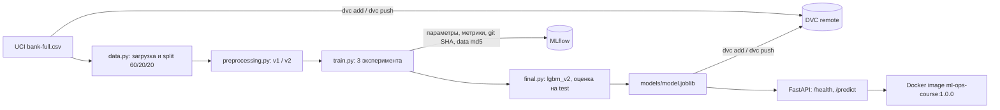

# Архитектура

Схема ML-процесса от данных до инференса.

## Компоненты

- **Данные:** `data/raw/bank-full.csv` версионируется DVC, в Git хранится только `.dvc`-файл с md5.
- **Эксперименты:** MLflow, каждый запуск логирует параметры, метрики validation, git SHA и md5 датасета.
- **Модель:** `models/model.joblib` содержит весь `Pipeline` (препроцессинг и классификатор), поэтому сервис применяет те же преобразования, что и при обучении.
- **Сервис:** FastAPI, модель загружается один раз при старте через `lifespan`, путь и версия берутся из переменных окружения `MODEL_PATH` и `MODEL_VERSION`.
- **Контейнер:** `python:3.12.14-slim-bookworm`, пользователь `appuser`, зависимости из `uv.lock`.
